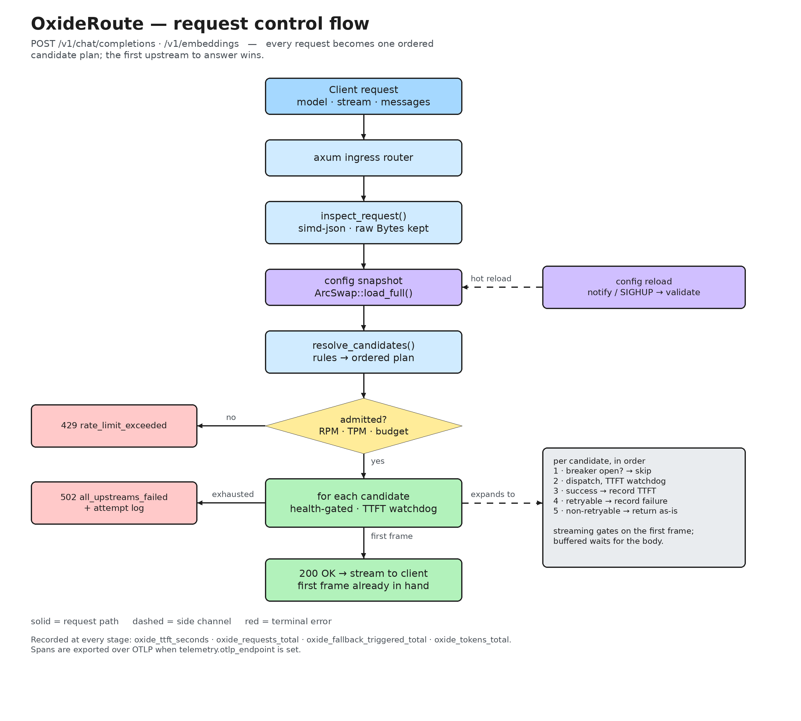

# OxideRoute

An ultra-low-latency, single-binary LLM router and API gateway in Rust. It sits
between your applications and upstream providers (OpenAI, Anthropic, Gemini, AWS
Bedrock, and any OpenAI-compatible server such as vLLM or Ollama), presenting a
single OpenAI-compatible API with declarative fallbacks, latency-aware load
balancing, per-tenant rate limiting, and zero-downtime config reloads.



*Editable source: [`docs/flow.excalidraw`](docs/flow.excalidraw) — open it at
[excalidraw.com](https://excalidraw.com).*

The defining property: **no downstream headers are sent until an upstream has
produced a first content frame.** A provider that accepts the connection, returns
`200`, and then stalls can still be replaced transparently.

## Quickstart

```bash
cargo build --release

# Scaffold a config
./target/release/oxide init --output oxide.toml

# Check it (structure only; no secrets needed)
./target/release/oxide validate --config oxide.toml

# See what would happen for a given prompt
./target/release/oxide dry-run --config oxide.toml --model gpt-4o --prompt "Hello"

# Serve
export OPENAI_API_KEY=sk-...
export ANTHROPIC_API_KEY=sk-ant-...
./target/release/oxide serve --config oxide.toml
```

## CLI

| Command | Purpose |
|---|---|
| `oxide serve [--config PATH]` | Run the gateway. Strict env interpolation; hot reload enabled. |
| `oxide validate [--config PATH] [--check-upstreams]` | Parse + semantic validation. `--check-upstreams` TCP-probes each `base_url`. |
| `oxide dry-run [--config PATH] --model M --prompt TEXT [--header K=V]` | Print the routing plan without calling an upstream. |
| `oxide init [--output PATH] [--force]` | Write a starter config. Refuses to clobber without `--force`. |
| `oxide schema` | Print the config JSON Schema (`oxide schema > oxide.schema.json`). |

`serve` parses strictly: an unset `${VAR}` aborts startup. The other commands are
lenient — placeholders are preserved — so tooling works on a machine without
production secrets.

## HTTP API

| Listener | Route | Description |
|---|---|---|
| ingress (`listen`) | `POST /v1/chat/completions` | Streaming (`stream: true`) and buffered completions. |
| ingress (`listen`) | `POST /v1/embeddings` | Pass-through embeddings (OpenAI-compatible upstreams). |
| ingress (`listen`) | `GET /healthz` | Liveness, so pod probes can use the serving port. |
| admin (`admin_listen`) | `GET {telemetry.prometheus_endpoint}` | Prometheus exposition (default `/metrics`). |
| admin (`admin_listen`) | `GET /healthz` | Liveness. |

Set `admin_listen` to keep `/metrics` off the public ingress; the scrape payload
exposes per-tenant and per-upstream traffic shape. If it is unset, `/metrics`
falls back to the ingress listener and `serve` logs a warning at startup.

Errors always use the OpenAI envelope, with extra diagnostics under
`oxide_metadata`:

```json
{"error":{"message":"all configured upstreams failed for model 'smart-router'",
 "type":"upstream_router_error","param":null,"code":"all_upstreams_failed",
 "oxide_metadata":{"request_id":"req_...","attempted_upstreams":[
   {"provider":"openai_us/gpt-4o","reason":"ttft_timeout_exceeded (2500ms)","elapsed_ms":2501},
   {"provider":"anthropic_prod/claude-3-7-sonnet-latest","reason":"http_status_429","elapsed_ms":84}]}}}
```

## Configuration

```toml
listen = "0.0.0.0:8080"

[providers.openai_us]
type = "openai"                    # openai | openai_compatible | anthropic | gemini | bedrock
api_key = "${OPENAI_API_KEY}"
timeout_ms = 60000                 # read/idle timeout per upstream read
ttft_timeout_ms = 2500             # pre-first-token watchdog

[models."smart-router"]
strategy = "latency_ewma"          # priority | weighted_random | latency_ewma
targets = [{ upstream = "openai_us/gpt-4o", weight = 70 }]
fallbacks = ["anthropic_prod/claude-3-7-sonnet-latest"]
retry_on_status = [429, 500, 503]

[[rules]]
name = "cost-aware"
condition = { model = "auto", complexity_score_below = 0.35 }
route_to = "openai_us/gpt-4o-mini"

[pricing."openai_us/gpt-4o"]       # optional; enables USD budget accounting
prompt_per_million_usd = 2.50
completion_per_million_usd = 10.00
```

Full examples: [`examples/minimal.toml`](examples/minimal.toml) and
[`examples/production.toml`](examples/production.toml). The authoritative schema
is generated from the Rust types via `oxide schema`.

### Bedrock credentials

The Bedrock adapter signs requests with SigV4 and reads credentials from the
environment (the AWS convention):

```bash
export AWS_ACCESS_KEY_ID=...
export AWS_SECRET_ACCESS_KEY=...
export AWS_SESSION_TOKEN=...        # optional
export AWS_REGION=us-east-1         # optional; or set base_url
```

Credential resolution is environment-only — no profile, IMDS, or SSO chain.

## Reloading

Edit the file and the watcher picks it up, or send `SIGHUP`:

```bash
kill -HUP $(pidof oxide)
```

Reloads are atomic: in-flight streams keep the config snapshot they started with
and complete undisturbed. An invalid file is rejected with a warning and the
previous configuration stays active.

## Observability

Metrics on `/metrics`:

| Metric | Type | Labels |
|---|---|---|
| `oxide_ttft_seconds` | histogram | `provider`, `model` |
| `oxide_requests_total` | counter | `provider`, `model`, `status` (`success`, `error`, `circuit_open`) |
| `oxide_fallback_triggered_total` | counter | `from_provider`, `to_provider`, `reason` |
| `oxide_tokens_total` | counter | `tenant`, `provider`, `token_type` |
| `oxide_rate_limited_total` | counter | `tenant`, `reason` (`rpm`, `tpm`, `budget`) |
| `oxide_inflight_requests` | gauge | — |
| `oxide_reload_total` | counter | `result` (`success`, `rejected`), `source` (`file`, `signal`, `manual`) |
| `oxide_breaker_open` | gauge | `upstream` |

`oxide_rate_limited_total` is what separates a throttle we applied from an
upstream's own `429`; `oxide_inflight_requests` counts streams until their last
frame, not until the handler returns; `oxide_breaker_open` is sampled from the
health table at scrape time, so a cooldown that lapses between requests still
reads as closed.

Logs are rendered and then passed through a PII redaction filter, so emails,
bearer tokens, vendor API keys, card numbers, and phone numbers are scrubbed
before they leave the process. Set `telemetry.otlp_endpoint` to also export spans
over OTLP/gRPC.

## Behaviour guarantees

- **No early `200`.** The response is constructed only after a first content
  frame exists, so failover on a stalled upstream is invisible to the client.
- **Zero-copy pass-through.** When routing does not rewrite the model, the
  original request bytes are forwarded (a refcount bump, not a copy).
- **Targeted rewrite.** When it does, only the top-level `model` string literal
  is spliced; key order, whitespace, and vendor fields survive.
- **Lock-free reads.** Config lives in an `ArcSwap`; health is atomics; the
  provider registry is a `DashMap`.
- **Bounded shutdown.** `SIGTERM`/`Ctrl-C` stops accepting, drains in-flight
  streams, and exits at `graceful_shutdown_timeout_ms` regardless — a stalled
  SSE stream cannot hold the process open past its budget.
- **No panics on the request path.** `src/proxy/`, `src/providers/`, and
  `src/telemetry/` contain no `unwrap`, `expect`, or `panic!` outside tests.

## Development

```bash
cargo fmt --all -- --check
cargo clippy --all-targets -- -D warnings
cargo test --all-targets          # 267 tests, fully offline
cargo bench --bench latency       # hot-path budgets
```

The test suite runs entirely offline: `tests/mock_upstreams.rs` is a
deterministic in-process Axum server with fault injection (429s, pre-header
stalls, post-header `: ping` stalls, slow streams), and it is shared by the
provider unit tests and the integration suites.

## Known limitations

- **Bedrock** does not verify event-stream CRC trailers and supports
  environment credentials only.
- **Spend accounting** requires a `[pricing]` entry; unpriced upstreams cost
  `0.0`, so a daily budget cannot constrain them.
- **Streaming responses** carry no upstream usage numbers, so only the prompt
  estimate is billed for them.
- **`reset` on reload** drops rate-limit bucket state (quotas may change) but
  deliberately preserves accrued spend.

## Documentation

- [`docs/GUIDE.md`](docs/GUIDE.md) — **walkthrough**: how each feature behaves, with diagrams
- [`docs/ARCHITECTURE.md`](docs/ARCHITECTURE.md) — module layout, traits, concurrency invariants
- [`docs/SPECS_AND_SCHEMAS.md`](docs/SPECS_AND_SCHEMAS.md) — config syntax, protocol translation, error schema
- [`docs/IMPLEMENTATION_PLAN.md`](docs/IMPLEMENTATION_PLAN.md) — build order
- [`docs/TESTING_AND_BENCHMARKS.md`](docs/TESTING_AND_BENCHMARKS.md) — mock server, chaos scenarios, budgets
- [`docs/STRESS_TEST_PLAN.md`](docs/STRESS_TEST_PLAN.md) — capacity, overload, soak, and lifecycle campaigns
