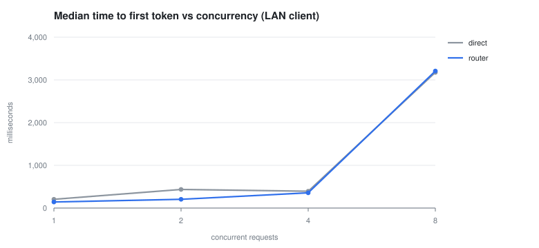
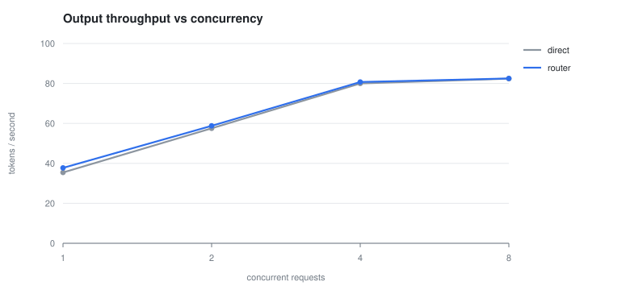
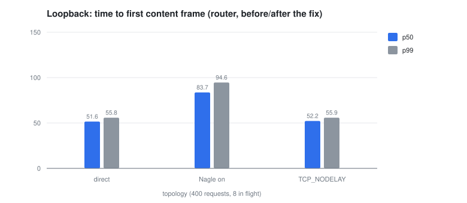

# OxideRoute benchmark report

End-to-end performance of `oxide` in front of a **local** LLM: LM Studio (llama.cpp) serving `Qwen3.8-27B-Q4_K_M` on the LAN. Every number below was produced by `bench/run.sh` on the hardware described in [Method](#method); the raw JSON is committed in `bench/results/`.

## Headline

- **1084 measured requests**, 1 failed (one request failed to send over the Wi-Fi link; no gateway errors).
- Through OxideRoute, one stream at a time: TTFT p50 **141 ms**, end-to-end p50 **1,659 ms**, **37.8 tok/s**.
- Aggregate throughput peaks at concurrency 8: **82.4 tok/s** direct, **82.5 tok/s** through the router — a ratio of 1.001.
- On loopback, where the network contributes nothing, the gateway costs **+0.5 ms** of end-to-end latency at p50 and **+0.6 ms** of TTFT.
- **Found and fixed a real defect:** `axum::serve` leaves `TCP_NODELAY` off, so Nagle delayed the first SSE frame by **31 ms** (84 ms → 52 ms p50). See [the A/B](#finding-tcp_nodelay).
- The pre-first-token contract holds on every stream: headers arrive 0.04 ms after the first content frame (p99 0.07 ms).

## Method

| | |
|---|---|
| Upstream | LM Studio / llama.cpp, `Qwen3.8-27B-Q4_K_M` (27.3 B params, Q4_K_M) |
| Upstream address | `192.168.68.61:8080`, reached over the LAN |
| Router | `oxide` release build, `127.0.0.1:8088`, config `bench/oxide.toml` |
| Load generator | `tools/loadgen.rs`, release build, closed loop, 2 warmup requests |
| Load generator host | Intel i7-1185G7, 8 threads, Linux 7.0, client and router co-located |
| Workload | one 76-character prompt, `temperature: 0`, `max_tokens: 64` unless stated |
| Thinking | disabled (`chat_template_kwargs.enable_thinking=false`) so token counts describe decode, not reasoning |
| Timeouts | `timeout_ms = 600000`, `ttft_timeout_ms = 60000`, so the watchdog never fires |
| Client↔upstream link | `23.174 ms min, 103.798 ms avg, 305.521 ms max, 73.113 ms mdev` |

Each request is timed from `send()` to the last byte. `headers_ms` is time to the response headers, `ttft_ms` time to the first non-empty `delta.content` frame, `itl_ms` the gaps between content frames, and `total_ms` the full stream. Percentiles are nearest-rank over successful samples; `tok/s` is completion tokens (from `usage`) divided by the wall-clock span of the run, so it includes queueing.

Three topologies are measured with identical requests:

```
loadgen ──LAN──> llama.cpp                        direct
loadgen ──lo──> oxide ──LAN──> llama.cpp          router
loadgen ──lo──> oxide ──lo──> mock upstream       loopback (gateway cost only)
```

The model is the bottleneck in the first two, and the Wi-Fi link between the two hosts is the largest source of noise. The third topology replaces both hops with loopback and a deterministic mock (`bench/mock.toml` + `demo/mock_upstream.py`), so the direct-vs-router difference there is the gateway's own cost.

## Results

### Direct to llama.cpp

| Conc | Reqs | OK | TTFT p50 | TTFT p90 | TTFT p99 | Total p50 | Total p99 | tok/s |
|---:|---:|---:|---:|---:|---:|---:|---:|---:|
| 1 | 30 | 30 | 205 | 642 | 1,411 | 1,703 | 2,302 | 35.5 |
| 2 | 30 | 30 | 435 | 721 | 1,101 | 2,163 | 2,661 | 57.5 |
| 4 | 30 | 29 | 394 | 660 | 990 | 3,047 | 5,091 | 80.0 |
| 8 | 30 | 30 | 3,176 | 3,411 | 3,615 | 6,033 | 6,417 | 82.4 |

### Through OxideRoute

| Conc | Reqs | OK | TTFT p50 | TTFT p90 | TTFT p99 | Total p50 | Total p99 | tok/s |
|---:|---:|---:|---:|---:|---:|---:|---:|---:|
| 1 | 30 | 30 | 141 | 270 | 686 | 1,659 | 2,184 | 37.8 |
| 2 | 30 | 30 | 205 | 333 | 3,436 | 2,031 | 3,908 | 58.8 |
| 4 | 30 | 30 | 357 | 541 | 612 | 3,095 | 3,394 | 80.7 |
| 8 | 30 | 30 | 3,208 | 3,432 | 3,569 | 6,047 | 6,365 | 82.5 |





## What the gateway costs

The real-model deltas are dominated by the link, not by `oxide`. Against an RTT with `mdev` of tens of milliseconds, a gateway that adds hundreds of microseconds cannot be resolved by subtracting two medians — at c1 the difference came out at -64 ms: negative, because the router's run happened to see a quieter link than the baseline's. That is the network, not the proxy.

| Conc | TTFT Δ p50 | Throughput ratio |
|---:|---:|---:|
| 1 | -64 ms | 1.065× |
| 2 | -230 ms | 1.022× |
| 4 | -37 ms | 1.009× |
| 8 | +32 ms | 1.001× |

Aggregate throughput is the one quantity the link does not corrupt: at c4 and c8, where the model is saturated, the two topologies differ by at most 0.9 %. The larger spread at c1 and c2 is run-to-run variation in the model's own batching — a single stream's decode rate moves by several percent between runs — not a gateway effect. That is the expected result for a streaming proxy with no buffering and no per-request serialization.

### Isolated: loopback, no network

400 requests, 8 in flight, fixed 50 ms frame pacing in the mock. In this configuration the client, the gateway, and the upstream share a host and the kernel, so every measured microsecond belongs to the processes under test.

| Path | TTFT p50 | TTFT p99 | Total p50 | Total p99 | tok/s |
|---|---:|---:|---:|---:|---:|
| direct to mock | 52 ms | 56 ms | 403 ms | 408 ms | 544.4 |
| through oxide | 52 ms | 56 ms | 404 ms | 408 ms | 554.5 |

The gateway adds **+0.5 ms** to p50 end-to-end latency and **+0.6 ms** to first token, at ~20 requests/s. This phase measures per-request cost, not capacity: the mock's 50 ms frame pacing caps it at roughly 20 rps, so neither path is near its limit.

## Finding: TCP_NODELAY

The first loopback run showed a signature that processing cost cannot produce: **+30 ms to the first frame, and no change to total time**. Headers were being held, not computation.

`axum` 0.7's `Serve` leaves `TCP_NODELAY` at the OS default, which is Nagle enabled. The gateway writes the header block and the first SSE frame as two small segments; Nagle holds the second until the first is acknowledged, and the client's delayed ACK supplies the pause. The fix is `.tcp_nodelay(true)` on both the ingress and the admin listener (`src/main.rs`).

| Path (loopback, c8) | TTFT p50 | TTFT p99 | Total p50 |
|---|---:|---:|---:|
| direct to mock | 52 ms | 56 ms | 403 ms |
| oxide, Nagle on | 84 ms | 95 ms | 404 ms |
| oxide, `TCP_NODELAY` | 52 ms | 56 ms | 404 ms |

The last row lands within a millisecond of the direct path, which is the correct outcome: with the socket flushing immediately, the gateway's first frame is bounded by its own copy and adds no measurable delay.



## Pre-first-token contract

Invariant 3 says the gateway must not commit `200 OK` downstream until the upstream has yielded a real content frame. The loader records both timestamps from one clock, so the contract is checkable per request: `ttft_ms - headers_ms` must be ~0.

| Metric | Value |
|---|---:|
| samples | 120 |
| p50 | 0.04 ms |
| p99 | 0.07 ms |
| max | 0.08 ms |

A positive gap means the headers landed just after the first token was in hand; a negative gap would mean the gateway answered before the upstream produced anything, which is the failure this section exists to catch.

## Longer generations (256 tokens, c4)

| Topology | TTFT p50 | Total p50 | Total p99 | tok/s |
|---|---:|---:|---:|---:|
| direct | 287 ms | 5,144 ms | 5,394 ms | 83.9 |
| router | 396 ms | 4,958 ms | 5,324 ms | 83.2 |

## Non-streaming path (c4)

| Topology | Total p50 | Total p99 | tok/s |
|---|---:|---:|---:|
| direct | 3,088 ms | 3,188 ms | 81.3 |
| router | 3,074 ms | 3,174 ms | 82.4 |

`stream: false` makes both the router and the upstream buffer the whole completion, so `ttft` equals `total` and there is no inter-token data. The two paths match within 1.5 %.

## Reading the numbers

The upstream dominates. A 27 B Q4 model decoding on a single GPU emits 35-40 tokens/s for a single stream and saturates near 82 tok/s aggregate, which at c8 is roughly 10 tokens/s per stream; the gateway's own work is measured in microseconds (`benches/latency.rs` budgets: 80 µs for request inspection, 5 µs for routing). The loopback phase is the only place the latter is visible.

Concurrency changes the shape, not the overhead. llama.cpp batches concurrent requests into one decode step, so aggregate throughput rises from ~36 tok/s to ~82 tok/s between c1 and c8 while per-request TTFT grows from hundreds of milliseconds to seconds. Both topologies follow the same curve: the router streams each upstream body as it arrives, so it adds no serialization point and no queue of its own.

## Limitations

- **The link is the noise floor.** Round-trip time to the model host was `23.174 ms min, 103.798 ms avg, 305.521 ms max, 73.113 ms mdev` during the run; a single request's TTFT varies by hundreds of milliseconds because of it. That is why the gateway-cost claim rests on the loopback phase.
- **One model, one machine, one sample per configuration.** 30 requests per cell gives a usable median and a single-sample p99; treat p99 as indicative.
- **`itl_ms` is frame cadence, not token cadence.** llama.cpp coalesces several tokens into one SSE frame, so this understates per-token latency and is only useful for comparing topologies.
- **Client and router share 8 cores.** A co-located load generator inflates the gateway's tail slightly at high concurrency; the effect is the same order as the measurements it would corrupt, so read the loopback numbers as an upper bound on overhead.
- **No failover, rate-limit, or breaker behaviour is measured here.** Those paths are covered by `tests/failover_tests.rs` and the scenarios in `docs/STRESS_TEST_PLAN.md`.
- **The loopback phase is not a capacity test.** The mock's fixed frame pacing caps it at ~20 rps; `oxide`'s throughput ceiling is not measured by this report.

## Reproducing

```bash
# with LM Studio serving the model at $UPSTREAM
bench/run.sh                 # writes bench/results/*.json
python3 bench/report.py      # rebuilds this file and the charts
```

Raw samples, including per-request timings, are in `bench/results/*.json`; `bench/results/metrics.txt` is a Prometheus scrape from the router after a 30-request run with the same configuration.
