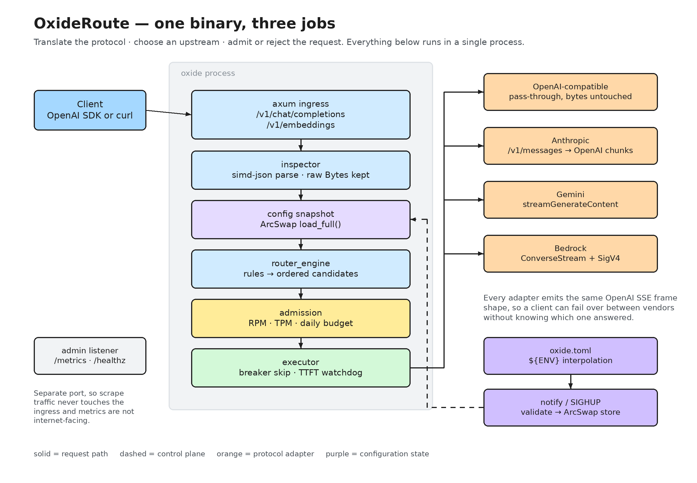
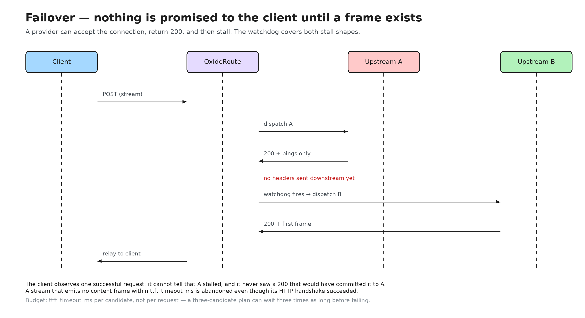
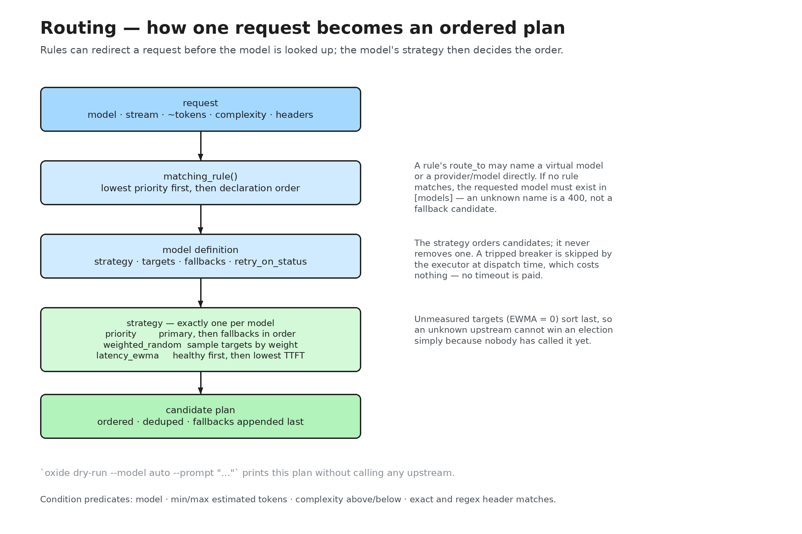
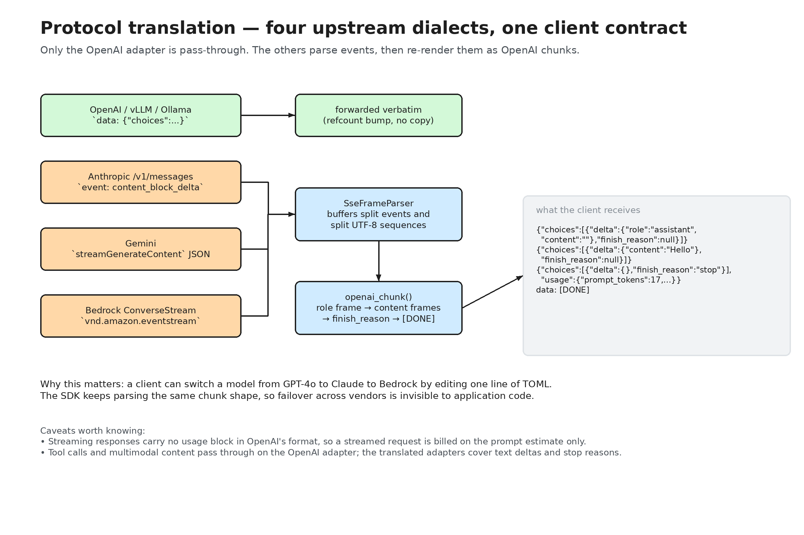
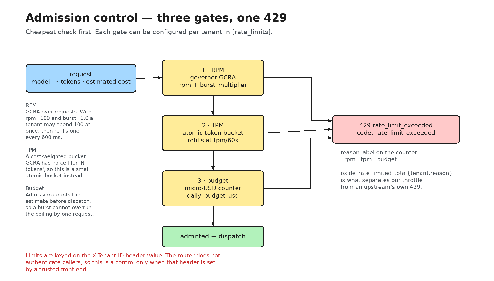
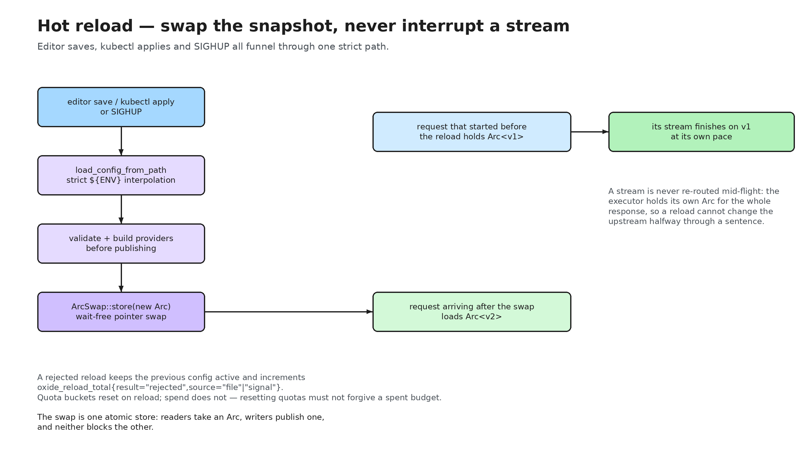

# OxideRoute — a walkthrough of what it does

This is the guided tour: what each feature is for, how a request moves through
the system, and where the sharp edges are. It is deliberately different from the
other documents:

| Document | Answers |
|---|---|
| [`overview.html`](overview.html) | "What is this, in one page?" |
| [`README.md`](../README.md) | "How do I run it?" |
| **This guide** | "How does it behave, feature by feature?" |
| [`ARCHITECTURE.md`](ARCHITECTURE.md) | "How is it built?" |
| [`SPECS_AND_SCHEMAS.md`](SPECS_AND_SCHEMAS.md) | "What exactly is the config/SSE syntax?" |
| [`STRESS_TEST_PLAN.md`](STRESS_TEST_PLAN.md) | "How do we prove it holds up?" |

Every diagram here is generated from `docs/diagrams/build.py`, which also checks
the geometry. The `.excalidraw` source sits next to each PNG and opens at
[excalidraw.com](https://excalidraw.com).

---

## 1. The mental model

OxideRoute is one process doing three jobs between an application and a set of
model vendors:

1. **Translate the protocol** — the client speaks OpenAI; upstreams may speak
   Anthropic, Gemini or Bedrock.
2. **Choose an upstream** — from a declarative plan, by rules, latency, or weight.
3. **Admit or reject** — per-tenant request, token, and spend ceilings.



Two properties explain most of the design:

- **A request carries its own config snapshot.** Nothing on the path takes a lock
  to read configuration, and a reload cannot split one request across two configs.
- **A response is not committed until an upstream produces a frame.** That is what
  makes failover on a stalled provider invisible to the caller.

---

## 2. Life of a request

The compact version of this path is drawn in [`flow.png`](flow.png); the sections
below expand each step.

### Step 1 — Ingress

`POST /v1/chat/completions` and `POST /v1/embeddings` are the only request paths.
The body arrives as a `Bytes` buffer that is **not** copied: it is forwarded
byte-for-byte when the upstream speaks OpenAI.

Bodies are capped at axum's default of 2 MiB. Beyond that the client gets a `413`
in axum's own shape, not the OpenAI envelope — this is the one known
conformance gap (see §11).

### Step 2 — Inspection

One pass with `simd-json` extracts four things and keeps the original buffer
untouched:

| Field | How it is derived |
|---|---|
| `requested_model` | the `model` string, before any rewrite |
| `is_stream` | `stream: true` |
| `estimated_prompt_tokens` | total text bytes ÷ 4 |
| `complexity_score` | 0–1 heuristic: length, fenced code blocks, reasoning keywords |

The token count is an estimate, not a tokeniser. It exists to drive `[rate_limits]`
and rule predicates cheaply; the authoritative usage comes from the upstream's
response for buffered calls.

A request id (`req_<32 hex>`) is minted here and echoed in errors, logs, traces,
and the `x-oxide-request-id` response header.

### Step 3 — Snapshot

`state.config()` returns an `Arc<RouterConfig>` loaded from an `ArcSwap`. The
whole request is resolved against this one snapshot, so a concurrent reload
cannot produce a plan built from two different configs.

### Step 4 — Routing

Rules are evaluated first; if none match, the requested model name is looked up
directly. Either way the result is an **ordered, deduplicated candidate list**
(§3).

### Step 5 — Admission

The tenant's RPM, TPM, and daily budget are checked before anything is
dispatched (§6). Rejection is a `429` with `code: rate_limit_exceeded`.

### Step 6 — Dispatch and failover

Candidates are tried in order. Each attempt gets its own time-to-first-token
budget; a provider that stalls is abandoned and the next candidate is used (§5).



### Step 7 — Response

| Request | What the client gets | When |
|---|---|---|
| `stream: true` | `text/event-stream`, first frame then the rest | as soon as a first content frame exists |
| buffered | JSON, upstream status preserved | after the upstream body completes |

Both carry `x-oxide-request-id` and `x-oxide-upstream` (e.g.
`anthropic_prod/claude-3-7-sonnet-latest`), which is the fastest way to answer
"who actually served this?".

---

## 3. Routing: from a model name to a plan



### Virtual models

A model is a name the client asks for and a plan the router follows. There are two
forms:

```toml
# Priority form: a primary and an explicit chain.
[models."gpt-4o"]
primary   = "openai_us/gpt-4o"
fallbacks = ["anthropic_prod/claude-3-7-sonnet-latest"]

# Load-balanced form: a strategy over weighted targets.
[models."smart-router"]
strategy  = "latency_ewma"
targets   = [
  { upstream = "openai_us/gpt-4o",      weight = 70 },
  { upstream = "anthropic_prod/claude-3-7-sonnet-latest", weight = 30 },
]
fallbacks = ["gemini_vertex/gemini-2.5-pro"]
retry_on_status = [429, 500, 502, 503, 504, 529]
```

Every entry is a `provider/model` reference where `provider` is a key under
`[providers]`. A bare name (no `/`) is treated as another virtual model, so chains
nest — up to a depth of 32, beyond which resolution fails rather than looping.

### Strategies

| `strategy` | Order of candidates |
|---|---|
| `priority` (default) | `primary`, then `fallbacks` in declaration order |
| `weighted_random` | one target sampled by weight, then `fallbacks` |
| `latency_ewma` | targets healthiest-first, then lowest observed TTFT, then `fallbacks` |

`latency_ewma` sorts, it does not filter: a target whose EWMA is unmeasured
(`0`) sorts **last**, so an untried upstream cannot win an election simply by
having no history. Fallbacks are appended after the strategy's output in all three
cases, and duplicates are removed.

The EWMA is per `provider/model`, updated on every successful first frame, and it
lives in atomics — no lock is taken to read it.

### Rules

A rule redirects a request before the model is looked up:

```toml
[[rules]]
name     = "long-prompts-to-the-big-model"
priority = 10
condition = { min_estimated_tokens = 32000 }
route_to  = "smart-router"
```

Conditions are ANDed, and a rule with no predicates is rejected at load time
(it would match everything). Available predicates:

| Predicate | Matches when |
|---|---|
| `model` | the requested model equals this string (e.g. `auto`) |
| `min_estimated_tokens` / `max_estimated_tokens` | the prompt estimate is in range |
| `complexity_score_above` / `_below` | the heuristic score is past the threshold |
| `header_matches` | each named header equals its value |
| `header_regex_matches` | each named header matches its regex |

Rules that set `priority` run first, lowest value first; rules without one run
after them, in declaration order. The first match wins.

`route_to` may name a virtual model or a `provider/model` directly.

### Seeing the decision without spending a token

`oxide dry-run` runs the real resolver — the same code the server uses — and
prints the plan:

```console
$ oxide dry-run --config production.toml --model auto --prompt "Summarise this contract"

Routing trace
=============
config:      production.toml
request id:  req_c3338a4ffc4d43d7b7e9a2bacb1a14ff
model:       auto
stream:      true
prompt:      ~28 tokens (estimated), complexity 0.00
matched:     rule `cost-aware-complexity-tiering`
retry on:    429, 500, 502, 503, 504, 529

#   PROVIDER           UPSTREAM MODEL                   HEALTH      EWMA(µs)
1   openai_us          gpt-4o-mini                      unknown            -

plan: try 1 upstream(s) in order, then fail the request
```

This is the tool for the "why did my request go there?" question, and the reason
routing config can be changed with confidence.

---

## 4. Talking to upstreams



### Provider types

| `type` | Wire protocol | Credentials |
|---|---|---|
| `openai` | `POST /v1/chat/completions` | `api_key` |
| `openai_compatible` | same, any base URL (vLLM, Ollama, LM Studio) | optional |
| `anthropic` | `POST /v1/messages`, `x-api-key` + version header | `api_key` |
| `gemini` | `streamGenerateContent` | `api_key` |
| `bedrock` | `ConverseStream` + hand-rolled SigV4 | env: `AWS_ACCESS_KEY_ID`, `AWS_SECRET_ACCESS_KEY`, `AWS_SESSION_TOKEN` |

```toml
[providers.local_ollama]
type      = "openai_compatible"
base_url  = "http://127.0.0.1:11434/v1"
ttft_timeout_ms = 1500
```

### What translation actually does

Only the OpenAI adapter is a true pass-through — it rewrites the top-level
`model` literal when routing changed it, and copies nothing else.

The other three parse the upstream's events with a single `SseFrameParser`, which
survives arbitrary chunk boundaries (including a split inside a multi-byte UTF-8
character) and then re-render each event as an OpenAI chunk:

```text
data: {"choices":[{"delta":{"role":"assistant","content":""},"finish_reason":null}]}
data: {"choices":[{"delta":{"content":"Hello"},"finish_reason":null}]}
data: {"choices":[{"delta":{},"finish_reason":"stop"}],"usage":{...}}
data: [DONE]
```

Stop reasons are mapped onto OpenAI's vocabulary, so an Anthropic `max_tokens`
arrives as `finish_reason: "length"` and a tool use as `"tool_calls"`.

**Limits worth knowing:** the translated adapters cover text deltas, stop
reasons, and error mapping. OpenAI-specific features (tool-call streaming shapes,
multimodal content) pass through unchanged on `openai`/`openai_compatible` but are
not synthesised for the other vendors.

### Timeouts

Two knobs per provider, and they mean different things:

- `timeout_ms` (default 60 s) — the HTTP client's connect and idle-read limit.
- `ttft_timeout_ms` (default 2.5 s) — the watchdog: how long a candidate may take
  to produce a *content* frame before it is abandoned.

There is no total-request timeout, deliberately: a long generation is not a fault.
The idle limit catches a dead socket; the watchdog catches a provider that
accepted the request and went quiet.

---

## 5. Failover and circuit breaking

Each candidate gets `ttft_timeout_ms` measured from the moment it is dispatched,
covering **both** stall shapes:

- it never returns headers (connection accepted, no response), and
- it returns `200` and then sends only `: ping` keep-alives.

Because no downstream header has been written yet, the request can be re-pointed
at the next candidate with the client none the wiser. Once a first content frame
exists, `200 OK` is sent and the stream is relayed — from that point a mid-stream
failure is visible to the client, as it must be.

Failover is triggered by transport errors, watchdog expiry, and upstream statuses
in `retry_on_status` (default `[429, 500, 502, 503, 504, 529]`). A `400`-class
error is returned as-is: the request itself is wrong and another vendor would
reject it identically.

### The breaker

Failures accumulate per `provider/model`. After
`consecutive_failures_threshold` (default 5) the candidate is ejected for
`cooldown_seconds` (default 15). While open it is skipped for free — no timeout
is paid — and it is not removed from the plan, only bypassed, so it returns on the
first success after the cooldown.

When every candidate fails, the response is a `502` whose
`oxide_metadata.attempted_upstreams` lists each attempt with a reason and elapsed
time:

```json
{"error":{"message":"all configured upstreams failed for model 'smart-router'",
 "type":"upstream_router_error","code":"all_upstreams_failed",
 "oxide_metadata":{"request_id":"req_...","attempted_upstreams":[
   {"provider":"openai_us/gpt-4o","reason":"ttft_timeout_exceeded (2500ms)","elapsed_ms":2501},
   {"provider":"anthropic_prod/claude-3-7-sonnet-latest","reason":"http_status_429","elapsed_ms":84}]}}}
```

---

## 6. Admission control



Three gates, cheapest first, all configured per tenant:

```toml
[rate_limits.acme]
match_header       = "X-Tenant-ID"   # default
rpm                = 600
tpm                = 250000
daily_budget_usd   = 50.00
burst_multiplier   = 1.5
```

| Gate | Mechanism | Behaviour |
|---|---|---|
| RPM | GCRA (`governor`) | burst of `rpm × burst_multiplier`, then one request per `60/rpm` s |
| TPM | atomic token bucket | capacity `tpm × burst_multiplier`, refills continuously at `tpm/60` per second |
| Budget | micro-USD counter | the estimate is counted before dispatch; the realised cost is recorded after |

TPM is a cost-weighted bucket rather than a GCRA cell because GCRA cannot express
"N tokens"; the bucket's CAS loop tolerates concurrent consumers without losing
updates.

**Rejections are distinguishable.** `oxide_rate_limited_total{tenant,reason}` with
`reason` = `rpm` | `tpm` | `budget` is what separates a throttle we applied from
an upstream's own `429`.

**Trust caveat.** The tenant is the value of the `X-Tenant-ID` header. The router
does not authenticate callers, so these limits only bind when that header is set
by a trusted front end. A client that rotates it gets a fresh bucket each time
(and grows the bucket map — see `STRESS_TEST_PLAN.md` §9.3).

---

## 7. Configuration and hot reload



### Loading

TOML is parsed with `${VAR}` interpolation:

- `serve` is **strict** — an unset variable aborts startup.
- `validate`, `dry-run`, `init`, `schema` are **lenient** — placeholders survive,
  so tooling works on a machine without production secrets.

`${VAR:-default}` supplies a fallback. Validation covers structure, provider
references, unknown upstream names in `fallbacks`, circular chains, and
`admin_listen` colliding with `listen`.

### Reloading

Writing the file (the `notify` watcher, 50 ms debounce) or sending `SIGHUP` runs
the same path: parse → validate → build provider adapters → one atomic swap. New
providers are constructed *before* publication, so a config whose adapters fail
to build is never visible.

In-flight requests keep the `Arc` they started with and finish on it. That is why
a reload during a long stream is safe, and why the quota buckets reset (quotas may
have changed) while spend does not (forgiving spend would defeat the budget).

### What needs a restart

| Setting | Reload | Restart |
|---|---|---|
| providers, models, rules, rate limits, pricing, resiliency | ✅ | |
| `listen`, `admin_listen`, `telemetry.prometheus_endpoint` | | ✅ |

A rejected reload is not an outage: the old config keeps serving and
`oxide_reload_total{result="rejected",source="file"|"signal"}` increments.

### Signals

| Signal | Effect |
|---|---|
| `SIGHUP` | reload config |
| `SIGTERM`, `SIGINT` | stop accepting, drain in-flight, hard-exit at `graceful_shutdown_timeout_ms` |

The drain deadline is real: an idle server exits immediately, and a server with a
stalled stream exits at the deadline with a warning rather than waiting for an
orchestrator to `SIGKILL` it.

---

## 8. Observability

### Two listeners

| Listener | Routes | Purpose |
|---|---|---|
| `listen` (default `0.0.0.0:8080`) | `/v1/chat/completions`, `/v1/embeddings`, `/healthz` | client traffic |
| `admin_listen` (optional) | `/metrics` (configurable), `/healthz` | operator traffic |

Set `admin_listen` and `/metrics` disappears from the public port entirely. Leave
it unset and the scrape endpoint falls back to the ingress with a startup warning
— useful for a laptop, not for production.

### Metrics

| Metric | Type | Labels |
|---|---|---|
| `oxide_ttft_seconds` | histogram | `provider`, `model` |
| `oxide_requests_total` | counter | `provider`, `model`, `status` |
| `oxide_fallback_triggered_total` | counter | `from_provider`, `to_provider`, `reason` |
| `oxide_tokens_total` | counter | `tenant`, `provider`, `token_type` |
| `oxide_rate_limited_total` | counter | `tenant`, `reason` |
| `oxide_inflight_requests` | gauge | — |
| `oxide_reload_total` | counter | `result`, `source` |
| `oxide_breaker_open` | gauge | `upstream` |

Two details that matter when reading them:

- `oxide_inflight_requests` counts a stream until its **last frame** (the guard
  lives inside the response body), not until the handler returns.
- `oxide_breaker_open` is sampled from the health table **at scrape time**, so a
  cooldown that lapses between requests still reads as closed.

### Traces and logs

Set `telemetry.otlp_endpoint` to export spans over OTLP/gRPC. Each dispatch is a
span carrying `request_id`, `model`, `tenant`, and `stream`.

Logs pass through a redaction filter *after* formatting, so emails, bearer
tokens, vendor API keys, card numbers, and phone numbers are scrubbed before they
leave the process. Payload logging is off by default (`log_payloads = false`).

---

## 9. The CLI

| Command | Use it when |
|---|---|
| `oxide init --output oxide.toml` | starting from a known-good skeleton |
| `oxide validate --config oxide.toml` | before every deploy; add `--check-upstreams` to TCP-probe base URLs |
| `oxide dry-run --model … --prompt …` | answering "where would this request go?" without calling anyone |
| `oxide schema > oxide.schema.json` | feeding editors and CI |
| `oxide serve --config oxide.toml` | running it |

`validate` prints the effective topology, including whether the scrape endpoint is
exposed publicly:

```console
$ oxide validate --config examples/production.toml
configuration OK: examples/production.toml
  listen:               0.0.0.0:8080
  admin_listen:         127.0.0.1:9090  (/metrics, /healthz)
  providers:            4
  models:               1
  routing rules:        3
  rate-limited tenants: 1
```

---

## 10. Errors

Every router-produced error uses the OpenAI envelope, with router detail under
`oxide_metadata`:

```json
{"error":{"message":"...","type":"upstream_router_error","param":null,
 "code":"all_upstreams_failed","oxide_metadata":{...}}}
```

| `code` | HTTP | Meaning |
|---|---|---|
| `invalid_request` | 400 | unparseable body, unknown model, no candidates |
| `rate_limit_exceeded` | 429 | RPM, TPM, or budget |
| `upstream_http_error` | 502 | upstream returned a non-retryable status |
| `upstream_transport_error` | 502 | connection failed |
| `all_upstreams_failed` | 502 | every candidate failed; includes the attempt log |
| `ttft_timeout_exceeded` | 504 | watchdog expired on a single-candidate plan |
| `circuit_breaker_open` | 503 | candidate ejected |
| `internal_error` | 500 | a bug, with operator detail in the message |

---

## 11. What is deliberately not implemented

Documentation that hides these would be worse than none:

| Area | State | Consequence |
|---|---|---|
| Ingress authentication | none | `X-Tenant-ID` is client-controlled; see §6 |
| Response cache | config accepted, **not wired** | `[cache] enabled = true` changes nothing today |
| Error-rate breaker | only the consecutive-failure trigger is wired | `error_rate_threshold_pct`, `window_seconds`, `active_probe_interval_seconds` are accepted but inert |
| `GET /v1/models` | absent | OpenAI SDK model-listing calls fail |
| Oversized bodies | axum's `413` | not the OpenAI envelope |
| Streaming usage | not billed | a streamed request is charged on the prompt estimate only |
| Bedrock | implemented, not tested against live AWS | SigV4 is verified against AWS's published test vector, not a real account |

Treat the second and third rows as the ones to fix before relying on the config
surface as documentation of behaviour.

---

## 12. Where to go next

- Run it: [`README.md`](../README.md)
- Config syntax and SSE frames: [`SPECS_AND_SCHEMAS.md`](SPECS_AND_SCHEMAS.md)
- Internals and concurrency invariants: [`ARCHITECTURE.md`](ARCHITECTURE.md)
- Correctness tests: [`TESTING_AND_BENCHMARKS.md`](TESTING_AND_BENCHMARKS.md)
- Capacity and soak campaigns: [`STRESS_TEST_PLAN.md`](STRESS_TEST_PLAN.md)
